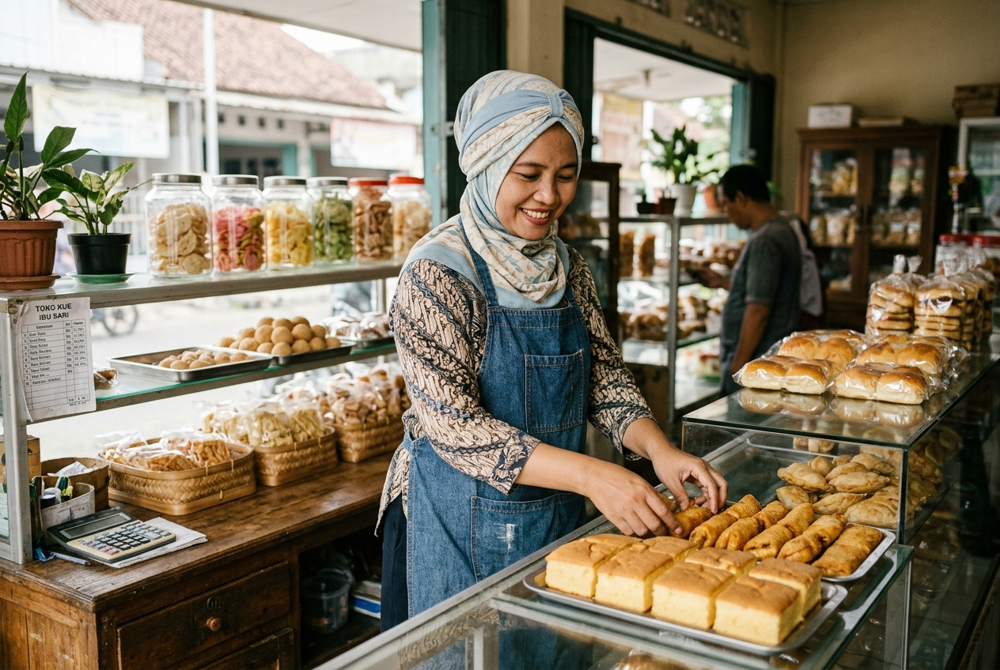

# Panduan Praktis Template & Cara Ganti Foto Website LAZ Wanita Islam

Dokumen ini berisi panduan lengkap untuk tim pengelola website LAZ Wanita Islam dalam mengimpor template ke Elementor / WordPress, panduan ukuran gambar, serta cara mudah mengganti foto-foto kegiatan asli di website.

---

## 1. Daftar Template Elementor yang Tersedia

Seluruh template siap pakai tersimpan di folder [`elementor-templates/`](file:///Users/samudra/Library/CloudStorage/OneDrive-ForumZakat/Downloads/Wanita%20Indonesia/elementor-templates/):

| Nama Template | Format File | Kategori | Penjelasan & Fungsi |
| :--- | :--- | :--- | :--- |
| **Widget 5 Pilar Program** | `widget-5-pilar-program.json` | Section Widget | Menampilkan 5 pilar program unggulan dengan kartu foto, tag pilar, poin intervensi, & tombol donasi. |
| **Widget Peta 10 Cabang** | `widget-peta-cabang.json` | Section Widget | Peta SVG Indonesia interaktif 10 cabang resmi (Sulut pengganti Papua), filter wilayah, & statistik. |
| **Template Postingan Berita** | `template-postingan.json` | Single Post | Layout artikel/kabar aksi lapangan: header, tanggal, estimasi baca, foto utama, kutipan, share, & CTA. |
| **Header Resmi** | `header-laz-wi.json` | Header | Topbar pengumuman, logo resmi LAZWI, menu navigasi responsif, & tombol *Tunaikan Zakat* emas. |
| **Footer Resmi** | `footer-laz-wi.json` | Footer | Footer 3 kolom (`dynamic-footer`) bebas pembatasan lebar tema Hello Elementor + info rekening Muamalat. |
| **Halaman Beranda** | `halaman-beranda.json` | Full Page | Halaman utama lengkap: Hero, Nilai, 5 Pilar, Kisah Nyata Ibu, Pengurus, Peta Cabang, Berita, & Donasi. |
| **Halaman Program** | `halaman-program.json` | Full Page | Halaman katalog detail 5 pilar program pemberdayaan perempuan & ketahanan keluarga. |
| **Halaman Tentang Kami** | `halaman-tentang-kami.json` | Full Page | Profil sejarah 60+ tahun Wanita Islam, legalitas, visi misi, & struktur dewan pengawas. |
| **Halaman Tunaikan Zakat** | `halaman-tunaikan-zakat.json` | Full Page | Kalkulator zakat maal/penghasilan, rekening resmi Bank Muamalat, QRIS, & form konfirmasi. |
| **Halaman Kabar & Laporan** | `halaman-kabar.json` / `halaman-laporan.json` | Full Page | Arsip berita dokumentasi lapangan dan publikasi laporan keuangan akuntabel. |

---

## 2. Standar Ukuran & Rasio Foto Website

Agar website tampil cepat, tajam, dan tidak berat diakses mustahik maupun muzaki lewat ponsel (HP), gunakan spesifikasi berikut:

| Bagian Website | Rekomendasi Resolusi | Rasio Aspek | Format Ideal | Ukuran Maksimal |
| :--- | :---: | :---: | :---: | :---: |
| **Foto 5 Pilar Program** | **1200 x 800 px** | **3:2** (atau 16:9) | JPG / WebP | < 300 KB |
| **Foto Utama Berita (Featured Media)** | **1200 x 675 px** | **16:9** | JPG / WebP | < 350 KB |
| **Foto Tokoh / Dewan Pengurus** | **400 x 400 px** | **1:1** (Persegi) | JPG / PNG | < 150 KB |
| **Logo Header & Favicon** | **1024 x 1024 px** | **1:1** (Transparan) | PNG | < 200 KB |
| **QRIS Resmi ZISWAF** | **950 x 1500 px** | Vertikal (Katalog) | JPG / PNG | < 250 KB |
| **Banner Under Maintenance** | **1920 x 1080 px** | **16:9** (Full HD) | PNG / JPG | < 400 KB |

> [!TIP]
> **Tips Optimasi Gambar:** Sebelum mengunggah foto ke WordPress, kompres foto menggunakan layanan gratis seperti [TinyPNG.com](https://tinypng.com/) agar ukuran berkas turun 70% tanpa mengurangi kualitas tampilan.

---

## 3. Langkah Demi Langkah Mengganti Foto di Website

Ketika dokumentasi foto asli kegiatan cabang LAZ Wanita Islam sudah siap, ikuti 4 langkah mudah berikut:

### Langkah 1: Unggah Foto ke Media Library WordPress
1. Masuk ke dashboard admin WordPress Anda (`namadomain.or.id/wp-admin`).
2. Klik menu **Media** > **Tambah Berkas Baru (Add New Media File)**.
3. Seret foto kegiatan Anda ke area upload.
4. Setelah terunggah, klik foto tersebut lalu klik tombol **"Salin URL ke Papan Klip (Copy URL to clipboard)"**.

### Langkah 2: Buka Editor Elementor
1. Buka halaman yang ingin diedit (misalnya Beranda atau Halaman Program).
2. Klik tombol **"Edit with Elementor"** di bilah atas.
3. Klik pada kotak widget **HTML** tempat 5 pilar program berada.

### Langkah 3: Cari Titik Penggantian Foto
Tekan **Ctrl + F** (Windows) atau **Cmd + F** (Mac) di dalam editor kode widget HTML, lalu cari kata kunci:
```html
<!-- [GANTI FOTO PILAR 1 DISINI] -->
```
Anda akan melihat baris kode gambar seperti berikut:
```html
<!-- [GANTI FOTO PILAR 1 DISINI] -->

```

### Langkah 4: Tempelkan Link Foto Asli Anda
Ganti isi di dalam `src="..."` dengan link foto yang Anda salin dari Media Library pada Langkah 1:
```html
<!-- CONTOH SETELAH DIGANTI: -->

```

Lakukan hal yang sama untuk Pilar 2, 3, 4, dan 5:
- `<!-- [GANTI FOTO PILAR 2 DISINI] -->` untuk Program Pendidikan
- `<!-- [GANTI FOTO PILAR 3 DISINI] -->` untuk Program Kesehatan
- `<!-- [GANTI FOTO PILAR 4 DISINI] -->` untuk Program Kemanusiaan
- `<!-- [GANTI FOTO PILAR 5 DISINI] -->` untuk Program Dakwah & Ketahanan Keluarga

### Langkah 5: Simpan Perubahan
Klik tombol hijau **"Update"** atau **"Publish"** di pojok bawah panel Elementor. Foto Anda langsung tayang secara profesional dan rapi!

---

## 4. Cara Mengimpor Template JSON ke WordPress Elementor

Jika ingin menambahkan bagian program atau peta cabang ke halaman baru:

1. Di WP-Admin, buka **Templates** > **Saved Templates**.
2. Klik tombol **"Import Templates"** di bagian atas layar.
3. Klik **Choose File**, lalu pilih berkas yang Anda butuhkan:
   - `widget-5-pilar-program.json` (untuk seksi 5 pilar program)
   - `widget-peta-cabang.json` (untuk seksi peta 10 cabang)
   - `template-postingan.json` (untuk layout berita/artikel)
4. Klik **"Import Now"**.
5. Saat mengedit halaman mana pun dengan Elementor:
   - Klik ikon **Folder Abu-abu (Add Template)** di dalam canvas Elementor.
   - Pilih tab **"My Templates"**.
   - Klik **"Insert"** pada template yang diinginkan.

---

## 5. Ringkasan Aset Siap Pakai yang Telah Disertakan

- **Foto Dokumenter Realistis 5 Pilar (Sudah Terpasang Otomatis):**
  - [pilar-1-ekonomi.jpg](file:///Users/samudra/Library/CloudStorage/OneDrive-ForumZakat/Downloads/Wanita%20Indonesia/assets/programs/pilar-1-ekonomi.jpg) (UMKM Ibu Tangguh)
  - [pilar-2-pendidikan.jpg](file:///Users/samudra/Library/CloudStorage/OneDrive-ForumZakat/Downloads/Wanita%20Indonesia/assets/programs/pilar-2-pendidikan.jpg) (Sekolah & Beasiswa)
  - [pilar-3-kesehatan.jpg](file:///Users/samudra/Library/CloudStorage/OneDrive-ForumZakat/Downloads/Wanita%20Indonesia/assets/programs/pilar-3-kesehatan.jpg) (Posyandu & Stunting)
  - [pilar-4-kemanusiaan.jpg](file:///Users/samudra/Library/CloudStorage/OneDrive-ForumZakat/Downloads/Wanita%20Indonesia/assets/programs/pilar-4-kemanusiaan.jpg) (Bencana & Rompi Ungu)
  - [pilar-5-dakwah-keluarga.jpg](file:///Users/samudra/Library/CloudStorage/OneDrive-ForumZakat/Downloads/Wanita%20Indonesia/assets/programs/pilar-5-dakwah-keluarga.jpg) (Majelis Taklim & Keluarga)
- **Aset Logo & Rekening:**
  - [Icon lazwi.png](file:///Users/samudra/Library/CloudStorage/OneDrive-ForumZakat/Downloads/Wanita%20Indonesia/Icon%20lazwi.png) (Logo resmi transparan)
  - [qris-laz-wanita-islam.jpg](file:///Users/samudra/Library/CloudStorage/OneDrive-ForumZakat/Downloads/Wanita%20Indonesia/assets/qris/qris-laz-wanita-islam.jpg) (QRIS Resmi Nasional)
  - [bank-muamalat.png](file:///Users/samudra/Library/CloudStorage/OneDrive-ForumZakat/Downloads/Wanita%20Indonesia/bank-muamalat.png) (Logo Bank Syariah)
- **Widget Mandiri Siap Copy-Paste:**
  - [program-5-pilar-elementor-widget.html](file:///Users/samudra/Library/CloudStorage/OneDrive-ForumZakat/Downloads/Wanita%20Indonesia/program-5-pilar-elementor-widget.html)
  - [peta-cabang-elementor-widget.html](file:///Users/samudra/Library/CloudStorage/OneDrive-ForumZakat/Downloads/Wanita%20Indonesia/peta-cabang-elementor-widget.html)
  - [postingan-elementor-widget.html](file:///Users/samudra/Library/CloudStorage/OneDrive-ForumZakat/Downloads/Wanita%20Indonesia/postingan-elementor-widget.html)
